##### Department of Electrical & Electronic Engineering
##### Imperial College London

#### **ELEC50001 Circuits & Systems**

### **Lab 5 – DAC and Function Generator**
##### *Peter Cheung, v4.0 - 16 Nov 2026*

#### **Learning Outcomes**

Lab 5 teaches you:
*   how to convert a digital value to a PWM signal,
*   use a lowpass filter to turn the PWM signal into an analogue voltage,
*   how to use SPI interface to send serial digital data to a DAC device,
*   how to generate a triangular signal,
*   how to control the frequency of the triangular signal.

The Lab requires you to use the Sallen-Key LP filter and the class-D audio amplifier that you built in Labs 1 and 2. You will also be using a DAC chip, the MCP4921, the datasheet of which is on the course webpage.

#### **Preparation**

Before you start task 1, take out the prototype shield included in the DE10-Lite box and stick the small breadboard onto the prototype PCB as shown below if required.  Without the DE10-Lite connected to power, carefully plug the prototype shield to the two rows of Arduino Headers. Make sure that the pins and sockets are aligned on the RIGHTHAND side as shown below.   Plug in 3 or 4 header pins to the GND sockets as shown. They will be useful for you to clip the scope probe ground croc-clips later.  Double check that you have plug the prototype shield into the header correctly.  The pins and sockets should be flush on the right side.

 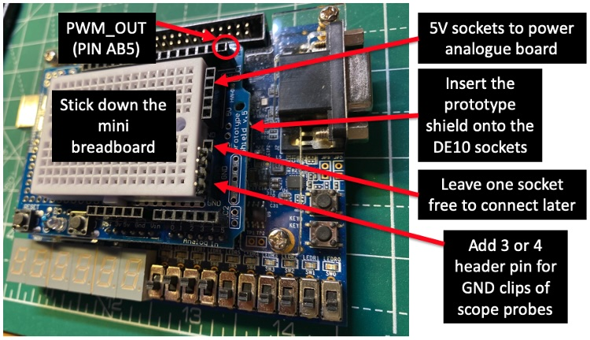 

---
### **Task 1: Digital to Analogue Conversion using PWM**
---
Before you start Task 1, use New Project Wizard, create a new project **lab5task1** in the **lab5/task1** folder.  

>**NOTE:** Make sure that the pin assignment file pin_assignment.txt you downloaded and various components you have used are put in your mylib folder.  This file contains all the pin assignment relevant to Lab 4, 5 and 6.

Open the file **_lab5task1.qsf_** immediately after the project is created, and change the device type from 10M08 to 10M50, and speed grade from 8 to 7 as shown here. (It is a shortcut, saving you having to change the Device Type inside Quartus.)

 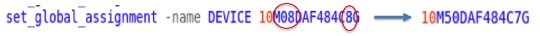 

Then go to end of the **.qsf** file and insert **_pin_assignment.txt_**.   Save and close **_lab5task1.qsf_**.  You are now ready to proceed.  As usual, the solution for Lab 5 Task 1 is available as a **.sof** file from the course webpage or the solution folder on this repo.

#### **Step 1:  Creating the pwm.sv module**

Shown above is the analogue PWM circuit you created in Lab 2, and a block diagram showing its digital equivalent of the **pwm.sv** module you are about to create for this task.  The principle of the digital PWM is covered during Lecture 8.  Essentially the analogue integrator is replaced by a RAMP generator circuit. Note that the output is a digital ramp – a series of numbers that goes up monotonically until it reaches the maximum value, and then it goes back down to zero. This is effective a counter! 

 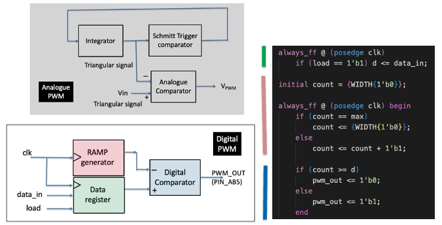 

 The analogue comparator is replaced with a digital comparator.  The analogue input in Lab 2 is now replaced by a digital value **data_in**, which is stored internally in the data register whenever load is asserted (high).

 The SystemVerilog specification for the digital PWM is shown above.  The interface specification for **_pwm.sv_** is define here. 

 
 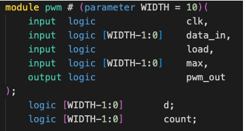 

 Create the pwm.sv module by adding all the other declarations required.

#### **Step 2: Test pwm.sv**

Create the top-level module lab5task1.sv that implements the circuit shown below:

 
 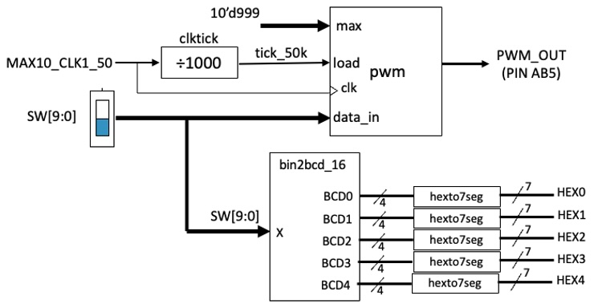 

 The **clktick** module is used to provide a load pulse lasting for 1 clock cycle (20ns) with a period of 20us. This effective determine the PWM sample frequency.

Check that the PWM circuit is working by measuring the **PWM_OUT** signal with a scope on **pin_AB5**, which is brought out on the Arduino Header pin as shown on page 1. 

What is the range of **data_in** that can be converted? Why?

#### **Step 3: Turn the PWM_OUT signal to an analogue voltage**

You built and tested a Sallen-Key lowpass filter in Lab 2 Task 4 on the analogue breadboard.  The filter has a corner frequency of around 2.7kHz.  You should resurrect this filter circuit and connect its input to the **PWM_OUT** signal as shown.

 
 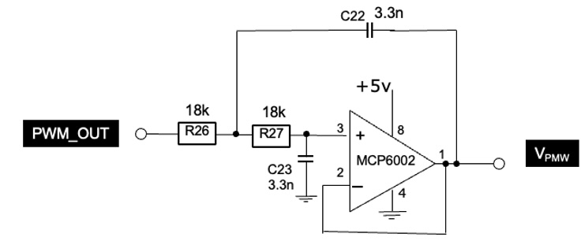 

The prototype shield has headers that provide 5V and GND for your analogue board.  Use two wires to bring the 5V and GND to the analogue breadboard as shown below.

 
 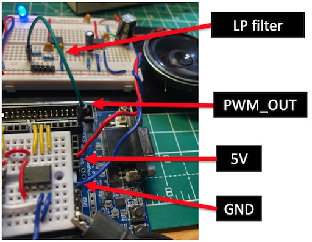 

 Measure the analogue voltage at the output of the LP filter with the scope or the multimeter for different value of SW.  You should explore the full range of values by checking the follow **SW[9:0]** settings: 10’h3FF, 10’h200, 10’h100, 10’h80, 10’h40 etc.  Why are these the correct values to explore?

What do you expect the relationship between VPWM voltage and the **SW[9:0]** value (which you can read off the 7-segment displays) to be?  Do your measurements agree with the prediction.  What is the range of input values that the PWM would convert correctly and why?

---
### **Task 2:  Digital to Analogue Conversion using the MCP4921 DAC device**
---

**Step 1:Connect the MCP4921 to DE10**  

Before we can design our interface circuit on the FPGA to the DAC device, we need to first wire it up to the DE10-Lite FPGA board.  Shown below is a wiring layout:

 
 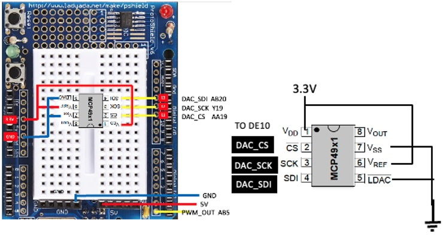 

Note the following:
1. The chip orientation is chosen to make wiring the signals to the header sockets as easy as possible.  Pin 2 to 4 of MCP4921 is aligned to the FPGA signal sockets.
2.	Check that you have connected the 3.3V and GND pins correctly before plugging in the USB cable.  Wrong connection of power might damage your chip permanently.

**Step 2:Understanding the Datasheet**  

Go to the course webpage and download the datasheet for the MCP4921 DAC and the file **_spi2dac.sv_**, which is a SystemVerilog module that implements the Serial Peripheral Interface (SPI) circuit to communicate with the DAC.  

Explore outside scheduled lab period the datasheet for the MCP4921 by considering:
* the purpose of each pin on the DAC (Section 3.0, page 17 of datasheet);
*   how information is sent to the DAC through the serial data input (SDI) pin (Section 5.0, page 23-24);
*   how to configure the DAC’s internal function (page 25);
*   DAC’s timing specifications and timing diagram (pages 4 and 7).

**Step 3:Verify and compare the DAC with PWM** 

To verify that the DAC works properly, create the top-level design **lab5task2** that implements the circuit shown in the following diagram.   Note that this is the same as Task1 except for the added spi2dac module and the connection to MCP4921.

 
 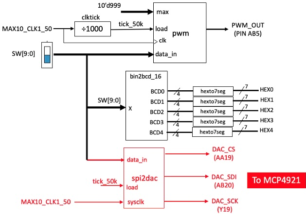 

The **data_in** value determined by the 10 switches (**SW[9:0]**) is loaded to the **spi2dac** module at a rate of 50k samples per second as governed by the load signal.   The steps for this part are:

1.	Create the new project **lab5task2**.
2.	Download from the experiment website the file **_spi2dac.sv_** to this project folder.
3.	Edit **_lab5task2.qsf_** file to specify the correct FPGA device and insert the **_pin_assignment.txt_** at the end of the **qsf** file.
4.	Modify **lab5task1.sv** from Task 1 to include the **spi2dac.sv** module.
5.	Click: **Project > Add/Remove Files in Project** …, and select all the relevant files used here.  This step is important – it allows you to select which modules to include in your design.
6.	When **_lab5task2.sv_** is the current file, click: **Project > Set as Top-Level Entity**.  This is another useful step, which defines the top module, and all those modules below this one, for compilation.  With steps 4 and 5, you can move up or down the design hierarchy in a project for compilation.
7.	Compile and correct errors as necessary.
8.	Program the DE10 with the generated **sof** file.

Compare the converter analogue voltage produce by the DAC (pin 8 of MCP4921) and that of the PWM (at the output of the LP filter) for different SW values.  Explain any differences.

**Step 4:Verify the signals on an oscilloscope** 	

It is interesting to study the signal produced by the **_spi2dac.sv_** module.  Connect the scope to the signals **DAC_CS** and **DAC_SDI** (trigger on **DAC_CS**).  Observe the waveforms when you change the **SW[9:0]**.  

---
### **Task 3: Triangular wave generator**
---

**Step 1:  A simple triangular wave generator**

Instead of driving the DAC and the PWM with fixed digital values (as defined by SW[9:0], create a new design where a 10-bit up-counter is providing the digital values as shown below. (Again, you should use the solution from Task2 as the prototype and add the counter to your design.)

 
 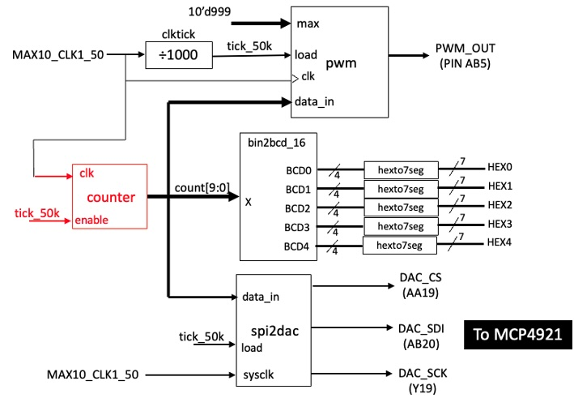 

Measure the output from the DAC and from the PWM.  Explain what you observe.

**Step 2: A variable frequency triangular wave generator**

To change the frequency of the triangular wave, you can replace the simple up-counter, which increments by 1 every 20us (50kHz rate), to one that increment by an integer n, which is a 10-bit number

 
 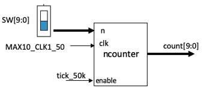 

Create a new module **_ncounter.sv_** according to the diagram below.  The increment value n is specified by **SW[9:0]**.

Modify **lab5task3** to include this new variable increment counter.  Check that changing SW value changes the frequency.

**Step 3: Hear the tune**

Resurrect the audio amplifier you built in Lab 1 Task 7 and connect either the low-pass filter output or the DAC output to PAM8302A class-D audio amplifier.  You should now be able to hear the triangular signal as you vary the frequency. 

 
 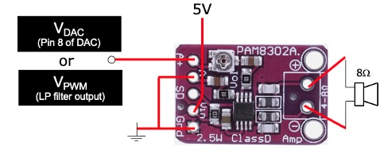 

 